# AALUMAI — Module Analysis

> Code-verified, module-by-module analysis of the AALUMAI Flutter/Dart application.
> Scope: documentation and diagnosis only. No behavior was changed to produce this document.

---

## 0. How to read this document

| Marker | Meaning |
| --- | --- |
| **PASS** | Behaviour is implemented and covered by an automated test that actually exercises it. |
| **PARTIAL** | Implemented, but a documented edge/flow is missing or only partly covered. |
| **FAIL** | Implemented incorrectly — behaviour contradicts the intent. |
| **MISSING** | Referenced by UI/schema/docs but not implemented at all. |
| **DEAD** | Implemented but never called anywhere in `lib/` (no runtime effect). |
| **UNVERIFIED** | Depends on a real device/OS (Android runtime) or couldn't be executed locally. |

Evidence is cited as `path:line`. Behaviour that requires a running Android device is
labelled **UNVERIFIED** because it cannot be observed locally without a device.

> **Update (2026-10-15):** the P0 alarm-reliability remediation, the strict
> sequential challenge-to-dismiss rework, **and the fitness-module redesign**
> have since been implemented. The original diagnosis below is kept for history;
> see the **“Update”** notes in §5 and §11 and the register in §18 for the
> resolved state. Current verified baseline: `flutter analyze` → *No issues
> found!*; full suite → **254 tests, all green** (including 85 fitness tests);
> debug APK → **builds successfully** (`build\app\outputs\flutter-apk\app-debug.apk`).
> The alarm-module compile error noted in an earlier revision has been fixed.

Verification baseline (original analysis): `flutter analyze` → *No issues found!*; `flutter test` → 143 tests pass.

---

## 1. Executive summary

AALUMAI (`ஆளுமை`, "personality") is a completely **offline, single-user, all-in-one
personal organiser**: alarms, schedule, tasks, habits, notes, fitness/workouts, money
(expenses + savings), meals, learning, and music. It has **no network layer** — all
state lives in a local Drift/SQLite database (`aalumai.sqlite`) plus `SharedPreferences`.

**Architecture in one line:** Riverpod (state) + Drift (SQLite) + go_router (navigation),
offline-first, no backend.

**Overall health:** the feature surface is broad and the code is consistent
(repository → provider → screen). The dominant real-world risk is **alarm
reliability**: the notification that fires is not the tone the user selected, and the
whole ring path is only verifiable on a device. The second-largest gap is the
**guided workout** module, which is visually complete but disconnected from its own
domain logic (personal records, progression suggestions, and run route data are all
dead code).

Highest-severity themes:

1. **Alarm tone mismatch** — scheduled notification uses the channel's default sound;
   the user-selected bundled tone only plays after `AlarmRingingScreen` opens.
2. **Full-screen-intent launch path is not wired to the tap handler** — the ringing
   screen may not open when the OS launches the activity via full-screen intent
   (device-dependent; **UNVERIFIED**).
3. **Exact-alarm capability is never checked** — `canScheduleExactAlarms()` is dead;
   scheduling failures are swallowed to `debugPrint`.
4. **Guided workout domain logic is dead** — `updatePersonalRecord`, `bestRecord`,
   `progressionSuggestion`, `activeSessionForPlan`, `waterTotalToday`, `watchRuns`
   are never called.
5. **Android runtime entirely UNVERIFIED** — build is blocked locally.

---

## 2. Module inventory

| Module | Entry screen(s) | Repository / data | DB tables | Route |
| --- | --- | --- | --- | --- |
| Core / Shell | `AppShell` (5 tabs) | providers, prefs | (all) | shell `/home /schedule /tasks /fitness /more` |
| Dashboard | `home_screen.dart` | `dashboard_config.dart` | — (SharedPreferences) | `/home`, `/dashboard-config` |
| Alarms | `alarms_screen`, `alarm_editor_screen`, `alarm_ringing_screen` | `alarm_repository.dart` | `alarms` | `/alarms` |
| Schedule | `schedule_screen` | `event_repository.dart` | `events`(+`event_exceptions`) | `/schedule` |
| Tasks | `tasks_screen` | `task_repository.dart` | `tasks` | `/tasks` |
| Habits | `habits_screen` | `habit_repository.dart` | `habits`, `habit_logs` | `/habits` |
| Notes | `notes_screen` | `note_repository.dart` | `notes` | `/notes` |
| Fitness | `fitness_screen`, `workout_player_screen`, `workout_plan_screen`, `exercise_detail_screen`, `run_walk_screen` | `fitness_repository.dart`, `run_tracker.dart` | `exercises`, `workout_sessions`, `workout_set_logs`, `personal_records`, `water_logs`, `body_measurements`, `workout_plans`, `workout_plan_items`, `fitness_goals` | `/fitness` |
| Finance | `expenses_screen` | `finance_repository.dart` | `accounts`, `categories`, `recurring_rules`, `transactions`, `budgets`, `debts`, `debt_payments` | `/expenses` |
| Savings | `savings_screen` | `finance_repository.dart` | `savings_goals` | `/savings` |
| Meals | `meals_screen` | `meal_repository.dart` | `meal_entries`, `food_items` | `/meals` |
| Learning | `learning_screen` | `learning_repository.dart` | `courses`, `lessons`, `learning_progress` | `/learning` |
| Music | `music_screen` | `music_repository.dart`, `player_service.dart` | `music_folders`, `music_tracks`, `playlists`, `playlist_items`, `music_state` | `/music` |
| Settings | `settings_screen` | `app_preferences.dart` | — (SharedPreferences) | `/settings` |
| More | `more_screen` | — | — | `/more` |
| About | `about_screen` | `app_info.dart` | — | `/about` |

---

## 3. System architecture

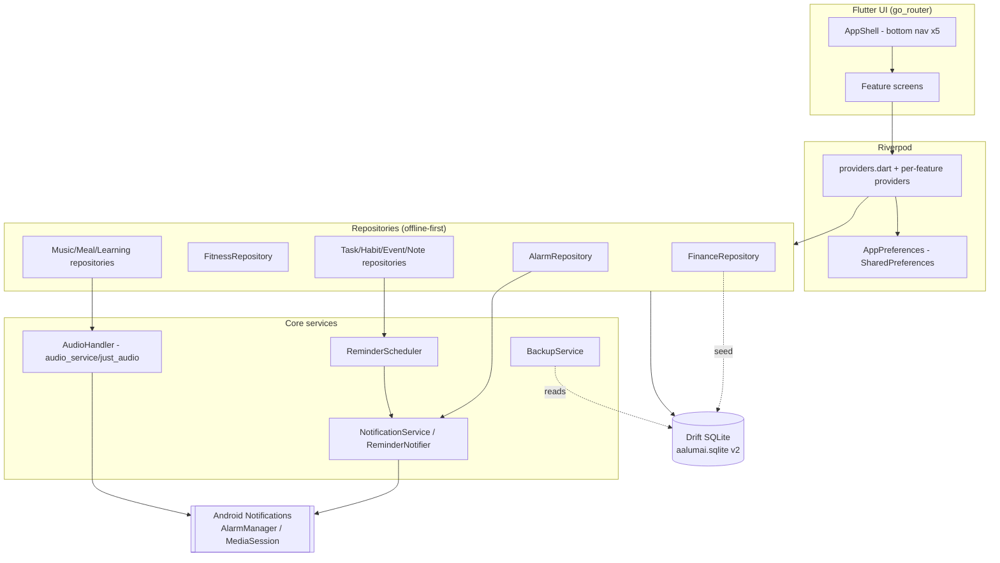

### Global startup / data flow

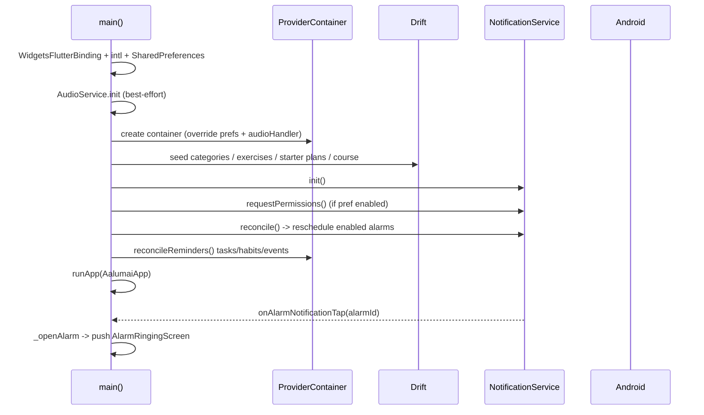

---

## 4. Core, Shell & Cross-cutting

### A. Overview
Bootstrap in `main.dart`, root widget in `app.dart`, 5-branch bottom navigation
(`AppShell`), and global infrastructure: Drift DB, providers, preferences, router,
notification/reminder services, and backup.

### B. Page-by-page UI
- `main()` — `WidgetsFlutterBinding.ensureInitialized()`, `initializeDateFormatting()`,
  `SharedPreferences.getInstance()`, optional `AudioService.init`, `ProviderContainer`
  overrides, `_bootstrap`, `runApp` (`main.dart:22-42`).
- `AalumaiApp` (`app.dart`) — first-run setup gate, theme + locale, `MaterialApp.router`.
- `AppShell` (`lib/core/shell/app_shell.dart`) — 5 destinations
  (Home, Schedule, Tasks, Fitness, More).
- `AppRoutes` constants — `app_router.dart:22-40`.

### C. Page linking
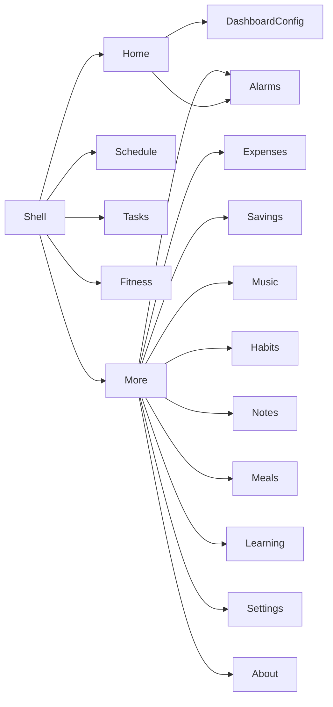

### D. Business logic
- Bootstrap is **best-effort**: every block in `_bootstrap` is wrapped in
  `try/catch` so a plugin/DB hiccup never blocks launch (`main.dart:67-99`).
- Alarm taps are funnelled through `onAlarmNotificationTap` → `_openAlarm`
  (`main.dart:80-81`, `116-148`). A module-level `_ringingAlarmId` guard prevents
  stacking two identical rings (`main.dart:111,117,134`).
- Cold start handling uses `getNotificationAppLaunchDetails()` (`notification_service.dart:75-78`).

### E. Data flow
`main() → ProviderContainer → repositories → Drift`. UI reads via Riverpod providers.

### F. Logic analyser

| # | Logic point | Status | Evidence |
| --- | --- | --- | --- |
| F1 | Bootstrap seeds + reconciles on startup | PASS | `main.dart:67-99`; `test/unit/reminder_wiring_test.dart` |
| F2 | Notification tap → ringing screen (cold + warm) | PARTIAL | `main.dart:116-148`; cold-start launch details `notification_service.dart:75-78` |
| F3 | Full-screen-intent launch opens ringing screen | UNVERIFIED | `notification_service.dart:144`; no dedicated callback wired |
| F4 | Schema version gating + migration | PASS | `database.dart:65,72-78` |
| F5 | Shared prefs keys well-defined | PASS | `app_preferences.dart` |
| F6 | Router covers every feature | PASS | `app_router.dart:22-40` |

### G. Tests
`test/unit/database_test.dart`, `test/unit/reminder_scheduler_test.dart`,
`test/unit/reminder_wiring_test.dart`, `test/widget_test.dart` (app name resolves
for all locales), `test/unit/enum_index_test.dart`.

### H. Improvements
1. Add an app-level integration test that pumps `AalumaiApp` and asserts the shell
   renders (currently no widget test boots the shell).
2. Document the bootstrap ordering in `docs/ARCHITECTURE.md` and keep it in sync.
3. Consider a visible "startup diagnostics" screen listing which bootstrap steps failed.

---

## 5. Alarms (highest-risk module)

### A. Overview
Schedules OS notifications via `flutter_local_notifications`, with an ordered
1–4 step dismissal-challenge sequence (math/memory/code, repeats allowed) and a
dedicated full-screen ringing activity. There is **no snooze and no in-app
dismiss**: the alarm stops only after every challenge is passed.

> **Update (2026-10-15) — implemented.** The write-up below the Update notes
> reflects the reworked module; historical findings are struck through in the
> register (§18).

### B. Page-by-page UI
- `alarms_screen.dart` — alarm list, enable toggle, next-ring times, FAB → editor,
  plus a `_SchedulingBanner` that surfaces exact-alarm blockage / scheduling
  errors with a one-tap fix.
- `alarm_editor_screen.dart` — time, label, repeat days, one-time flag, sound
  picker, volume, vibrate, and a **challenge-sequence editor** (`_ChallengeSequenceTile`):
  add up to four challenges, reorder them, and remove any (always ≥ 1).
- `alarm_ringing_screen.dart` — full-screen; loops the selected bundled tone via
  `AlarmAudio` (`alarm_audio.dart`) and steps through the challenge sequence one
  at a time. Shows the alarm time and progress ("Challenge X of N"); incorrect
  answers keep the alarm ringing. No snooze/dismiss buttons.
- `alarm_challenges.dart` — `AlarmChallengeData`, `AlarmChallengeGenerator`
  (math/memory/code) and the pure `AlarmChallengeSequence` (decode/encode/resolve).
- `data/alarm_repository.dart` — persistence + schedule lifecycle (`complete()`).
- `ringing_coordinator.dart` — prevents duplicate ringing sessions.

### C. Page linking
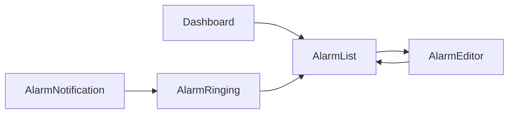

### D. Business logic
- `AlarmChallenge { none, math, memory, code }` (`alarm_repository.dart:11-19`).
- **Challenge sequence** is the source of truth: persisted as a comma-separated
  `challengeSequence` column (`tables.dart`), capped at 4, repeats preserved.
  `AlarmChallengeSequence.resolve(raw, legacyType)` returns 1–4 items, falling
  back to the legacy single `challengeType`, then to a default math challenge, so
  the ring is always completable (`alarm_challenges.dart`).
- **Sequential runner**: `_AlarmRingingScreenState` advances only on a correct
  answer; the last correct answer calls `_complete()` which stops audio/vibration
  and invokes `AlarmRepository.complete()` (`alarm_ringing_screen.dart`).
- **Audio continuity**: the tone loops; a wrong answer never stops it; the loop
  is re-asserted on `AppLifecycleState.resumed` and only `_complete()`/`dispose()`
  stop it.
- `create()` inserts and schedules only when enabled, storing both the primary
  `challengeType` and the encoded `challengeSequence` (`alarm_repository.dart`).
- **Scheduling**: `AlarmPlanner.plan` emits one entry for daily/one-time (slot 0)
  and one per selected weekday — no duplicate ids (`alarm_scheduler.dart`).
- **Exact alarms**: capability is checked (`refreshCapability`), requested on
  demand, and failures are surfaced via `AlarmSchedulingStatus` instead of being
  swallowed; scheduling falls back to inexact-alarm mode when exact is denied.
- `complete()` cancels the schedule, clears any legacy snooze, disables one-time
  alarms and re-arms repeating ones (`alarm_repository.dart`).
- `reconcile()` cancels all alarm slots first, then re-arms the enabled set
  (`alarm_repository.dart`).

### E. Data flow
`AlarmEditor → AlarmRepository.create/updateAlarm → NotificationService.scheduleAlarm
→ Android AlarmManager → notification (+full-screen intent) → tap → _openAlarm →
AlarmRingingScreen → (pass all challenges) → AlarmRepository.complete`.

### F. Logic analyser

| # | Logic point | Status | Evidence |
| --- | --- | --- | --- |
| F1 | Alarm CRUD + toggle + reconcile | PASS (unit) | `test/unit/alarm_time_test.dart`, `alarm_challenges_test.dart` |
| F2 | Sequential challenge gating (all must pass) | PASS (widget) | `test/widget/alarm_ringing_test.dart`, `alarm_challenges.dart` |
| F3 | Selected alarm tone rings (raw resource + versioned channel) | PASS (logic) / UNVERIFIED (device) | `notification_service.dart`, `alarm_scheduler.dart` `rawSoundFor` |
| F4 | Full-screen-intent launch shows ringing screen | UNVERIFIED | handler via tap/launch-details; device-dependent |
| F5 | Exact-alarm capability check + request + banner | PASS (logic) | `alarm_repository.dart` (`refreshCapability`/`requestExactAlarms`), `_SchedulingBanner` |
| F6 | Scheduling failures surfaced to user | PASS | `AlarmSchedulingStatus.lastError` + banner |
| F7 | Daily alarm schedules exactly once | PASS | `AlarmPlanner.plan` slot 0 |
| F8 | Reconcile cancels stale/disabled alarms | PASS | `reconcile()` cancels all slots then re-arms enabled |
| F9 | `gradualVolume`/`soundStartMs`/`soundEndMs` have effect | DEAD | still stored only (documented) |
| F10 | No snooze / no in-app dismiss; audio stops only after all challenges | PASS (widget) | `alarm_ringing_screen.dart` |
| F11 | Order configurable + persists; legacy alarms migrate | PASS (unit) | `AlarmChallengeSequence`, schema v3 migration |

### G. Tests
`test/unit/alarm_time_test.dart`, `test/unit/alarm_challenges_test.dart`
(incl. `AlarmChallengeSequence`), `test/widget/alarm_ringing_test.dart`
(sequential runner + no-snooze/near-audio-continuity via a fake audio backend).
**No test asserts the OS tone or full-screen intent** (would require a device).

### H. Improvements (priority)
1. **P0 — done** — ring with the selected tone (raw resource + per-sound channels).
2. **P0 — done** — check/request exact alarms and surface a banner.
3. **P0 — done** — sequential challenge-to-dismiss; no snooze/dismiss; audio
   continues until all challenges pass.
4. **P1 — done** — one schedule per daily alarm; reconcile cancels stale slots.
5. **P2** — implement or remove `gradualVolume`/`gradientDurationSec`/sound-range columns.
6. **UNVERIFIED** — device-test full-screen-intent launch, lock-screen takeover,
   tone accuracy, and boot/timezone reconcile.

### Device verification steps (UNVERIFIED locally)
- Build & install on Android 12 and 13+; grant exact-alarm + full-screen intent.
- Set an alarm with a non-default tone and a multi-step sequence; lock the screen;
  confirm the **chosen tone** plays, the ringing screen appears without a tap, and
  the alarm only stops after all challenges are passed.
- Toggle an alarm off, reboot, confirm it does not ring.
- Note: the power/volume buttons, force-stop and reboot are OS-controlled and
  cannot be blocked by the app.

---

## 6. Dashboard / Home

### A. Overview
Composable landing page of configurable sections, plus quick actions.

### B. Page-by-page UI
- `home_screen.dart` — renders sections in configured order, hiding disabled ones.
- `dashboard_config` screen — reorder/hide sections.

### C. Page linking
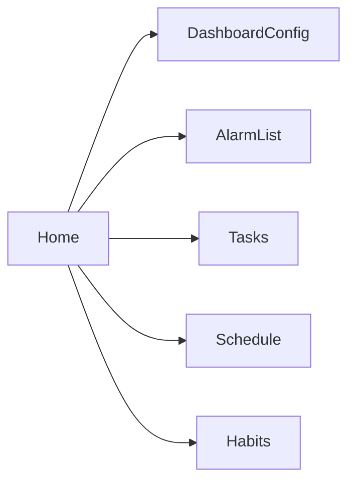

### D. Business logic
- `DashboardSection { quickActions, summary, events, tasks, habits }`.
- `DashboardConfig { order, hidden }` persists **only in SharedPreferences**
  (`dashboard_order`, `dashboard_hidden`); there is **no DB table** (asserted absent
  in `test/unit/database_test.dart:52-53`).
- `dashboardConfigProvider` exposes config to `home_screen`.

### E. Data flow
`Home → dashboardConfigProvider (SharedPreferences) → section widgets → feature providers`.

### F. Logic analyser

| # | Logic point | Status | Evidence |
| --- | --- | --- | --- |
| F1 | Order/hidden config parse & defaults | PASS | `test/unit/dashboard_sections_test.dart`, `test/widget/dashboard_config_test.dart` |
| F2 | Config persists across restarts | PASS (unit) | `dashboard_config.dart` + prefs |
| F3 | Sections render per config | PARTIAL | `home_screen.dart` (no dedicated widget test) |

### G. Tests
`test/unit/dashboard_sections_test.dart`, `test/widget/dashboard_config_test.dart`.

### H. Improvements
1. Keep dashboard config out of backup unless intentionally included (currently prefs-only).
2. Add a widget test that boots `home_screen` with a non-default config.

---

## 7. Schedule

### A. Overview
Calendar of events with reminders and recurrence.

### B. Page-by-page UI
- `schedule_screen.dart` — day/agenda list, event editor dialog/sheet.

### C. Page linking
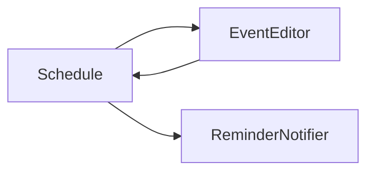

### D. Business logic
- `event_repository.dart` — CRUD + `reconcileReminders()` (called at startup,
  `main.dart:96-98`). Reminder ids use `eventBase = 2000000`
  (`reminder_scheduler.dart:20-29`).
- **Exceptions are dead**: `event_exceptions` table + `addException` exist but there
  is no UI to add an exception and no reader (`event_repository.dart`, table defs).
- Recurrence logic exists and is unit-tested (`recurrence.dart`,
  `recurring_rules.dart`) but the event editor has **no recurrence picker**.

### E. Data flow
`Schedule → eventRepository → events table → ReminderScheduler → NotificationService`.

### F. Logic analyser

| # | Logic point | Status | Evidence |
| --- | --- | --- | --- |
| F1 | Event CRUD | PASS (unit) | `test/unit/event_repository_test.dart` |
| F2 | Recurrence expansion | PASS (unit) | `test/unit/recurrence_test.dart`, `recurring_rules_test.dart` |
| F3 | Reminder scheduling | PASS (unit) | `test/unit/reminder_scheduler_test.dart` |
| F4 | Event exceptions usable | **DEAD** | `event_exceptions` + `addException` unread/unwired |
| F5 | Recurrence reachable from UI | **MISSING** | no picker in editor |

### G. Tests
`test/unit/event_repository_test.dart`, `recurrence_test.dart`,
`recurring_rules_test.dart`, `reminder_scheduler_test.dart`.

### H. Improvements
1. Add a recurrence picker to the event editor (logic already exists + tested).
2. Either implement event exceptions UI or remove the dead table/method.

---

## 8. Tasks

### A. Overview
To-do items with due dates, priority, reminders, and tags.

### B. Page-by-page UI
- `tasks_screen.dart` — list, add/edit, complete, due reminders.

### C. Page linking
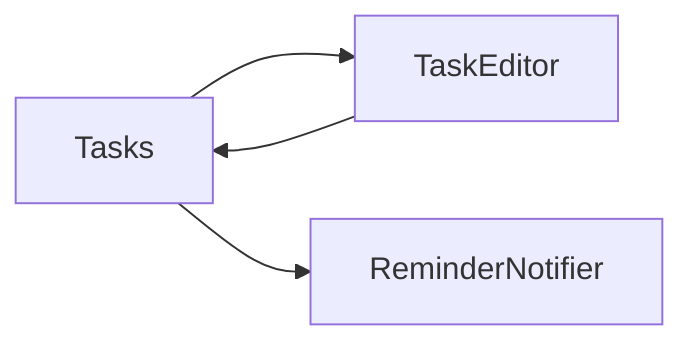

### D. Business logic
- `task_repository.dart` — CRUD + `reconcileReminders()` (`main.dart:90-92`).
  Reminder ids use `taskBase = 1000000` (`reminder_scheduler.dart:20-29`).
- `tagIds` are persisted but **never displayed**.

### E. Data flow
`Tasks → taskRepository → tasks table → ReminderScheduler → NotificationService`.

### F. Logic analyser

| # | Logic point | Status | Evidence |
| --- | --- | --- | --- |
| F1 | Task CRUD + completion | PASS (unit) | `test/unit/reminder_wiring_test.dart` and repo tests |
| F2 | Due-date reminders | PASS (unit) | `reminder_scheduler.dart`, `reminder_wiring_test.dart` |
| F3 | Tags shown to user | **DEAD** | `tagIds` stored, never rendered |

### G. Tests
`test/unit/reminder_wiring_test.dart`; widget coverage limited.

### H. Improvements
1. Surface tags (filter/colour) or drop the field.
2. Add overdue highlighting test.

---

## 9. Habits

### A. Overview
Daily/weekly habits with streak tracking and reminders.

### B. Page-by-page UI
- `habits_screen.dart` — habit list, check-in, streaks.

### C. Page linking
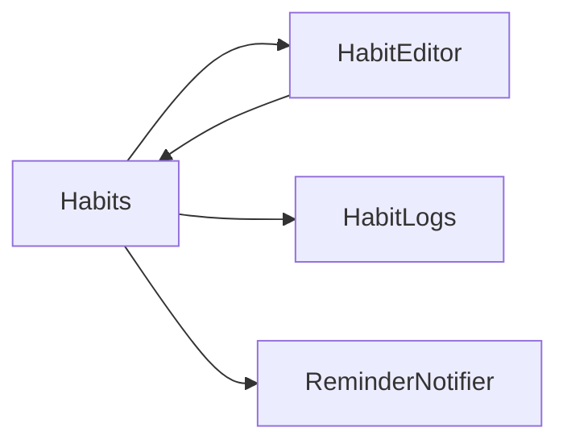

### D. Business logic
- `habit_repository.dart` — CRUD + logs + `reconcileReminders()` (`main.dart:93-95`).
  `habitReminderId = habitBase + habitId*10 + weekday`
  (`reminder_scheduler.dart:20-29`), weekday 1..7.
- Streak logic unit-tested (`habit_streak.dart`).
- **Weekly-target habits always show streak 0** because `habits_screen` uses
  `currentDayStreak` only; `currentWeeklyStreak`/`bestWeeklyStreak` are **DEAD**.
- `isMeasurable` / `goalValue` / `unit` are stored but **never displayed**.

### E. Data flow
`Habits → habitRepository → habits + habit_logs → streak util → UI`.

### F. Logic analyser

| # | Logic point | Status | Evidence |
| --- | --- | --- | --- |
| F1 | Daily streak math | PASS (unit) | `test/unit/habit_streak_test.dart` |
| F2 | Weekly-target streak display | **FAIL** | screen uses `currentDayStreak`; weekly methods dead |
| F3 | Measurable habit progress shown | **DEAD** | `isMeasurable/goalValue/unit` unused in UI |
| F4 | Reminders | PASS (unit) | `reminder_scheduler.dart`, `reminder_wiring_test.dart` |

### G. Tests
`test/unit/habit_streak_test.dart`, `test/unit/reminder_wiring_test.dart`.

### H. Improvements
1. Use weekly streak for weekly-target habits; add a unit test.
2. Display measurable progress, or remove the fields.

---

## 10. Notes

### A. Overview
Free-form notes.

### B. Page-by-page UI
- `notes_screen.dart` — list + editor.

### C. Page linking

### D. Business logic
- `note_repository.dart` — CRUD.
- The FAB **creates an empty note immediately**, so backing out leaves an orphan
  empty note.
- `noteRepository.delete` has **no callers** (DEAD).
- `tagIds` stored but never displayed.

### E. Data flow
`Notes → noteRepository → notes table`.

### F. Logic analyser

| # | Logic point | Status | Evidence |
| --- | --- | --- | --- |
| F1 | Note CRUD | PARTIAL | repo present; delete unused |
| F2 | No orphan notes on cancel | **FAIL** | FAB inserts before editing |
| F3 | Tags shown | **DEAD** | `tagIds` never rendered |

### G. Tests
No dedicated notes test found.

### H. Improvements
1. Create the note lazily (only on first save) or auto-delete empty notes on back.
2. Wire delete (swipe/menu) or remove it.
3. Show tags or drop the field.

---

## 11. Fitness (second priority)

### A. Overview
Guided workout plans, a weekly planner driven by user preferences, a
readiness-gated set/rep player with warm-up/main/cool-down phases, a structured
exercise library, run/walk tracking, water, body measurements, and goals.

> **Update (2026-10-15) — redesigned.** The module now has a configurable weekly
> planner and a WHO-informed activity-guidance card; the player captures
> readiness before training and records a `SessionOutcome`. The formerly dead
> domain logic (personal records aside) is superseded by the new planner/session
> pipeline.

### B. Page-by-page UI
- `fitness_screen.dart` — tabs: Workout, History, Water, Goals (and library/plans).
  The Workout tab now links to the **weekly planner** and shows a **WHO-informed
  activity-guidance card**.
- `weekly_planner_screen.dart` — Mon–Sun planner with week navigation, generate-
  from-preferences, and per-entry actions (start/edit/move/reorder/duplicate/mark-
  rest/restore/skip/delete) plus advisory warnings.
- `workout_preferences_screen.dart` — plan style, level, session length,
  training/rest days, goal, focus muscles, equipment, preferred time, and a
  safety acknowledgement; persisted in `workout_prefs`.
- `workout_player_screen.dart` — readiness check gate, phase-aware guided player
  (work/rest, set logging, timer), outcome-aware summary.
- `workout_plan_screen.dart` — plan builder (add/reorder items).
- `exercise_detail_screen.dart` — exercise info, type chip, form tips / common
  mistakes / contraindications, and easier/harder substitutes.
- `run_walk_screen.dart` — GPS run/walk tracker.

### C. Page linking
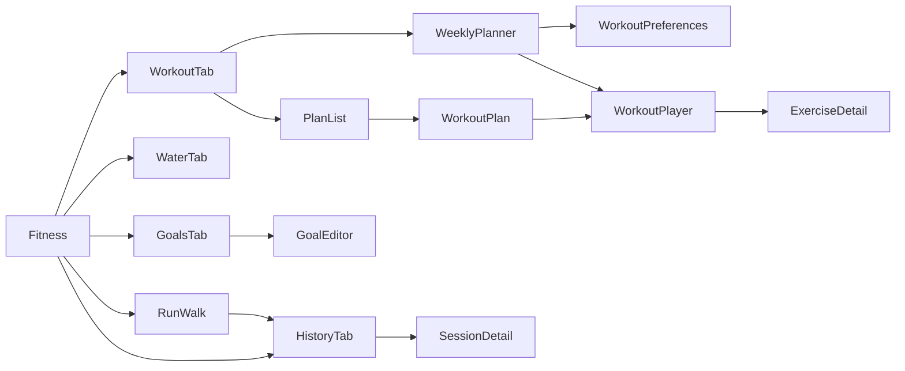

### D. Business logic
- Repository methods (`fitness_repository.dart`): exercises, sessions, set logs,
  water, measurements, plans/items, goals, `seedExercises`, `seedStarterPlans`,
  and the redesign additions — `preferencesRow`/`savePreferences`,
  `watchWeek`/`addScheduleEntry`/`updateScheduleStatus`/`moveScheduleEntry`/
  `duplicateScheduleEntry`/`generateWeek`, plus `startSession(scheduledId:)`/
  `finishSession(outcome:)`.
- **Preferences** are modelled by `WorkoutPreferences` (plan style, level,
  `sessionMinutes`, training/rest-day masks, goal, goal muscles, equipment,
  preferred time, substitutions, safety ack) — stored as a single `workout_prefs`
  row.
- **Weekly planner**: `WeeklyPlannerScreen` reads `scheduleWeekProvider(weekStart)`
  (Mon-first). `WeekPlanGenerator` turns preferences + the exercise library into
  per-day plans; `WeekDates` provides week math; `WorkoutSchedules` rows carry
  `planned`/`completed`/`skipped`/`rest`/`missed` status (Monday-first bits).
  Warnings (consecutive days / repeated muscle groups) are advisory and never
  block.
- **Session flow** (`session_flow.dart`): `SessionBuilder.buildSession` composes
  warm-up → main → cool-down and tags each `WorkoutStep` with a `SessionPhase`
  (index 1 = main, so pre-phase queues still decode). `ReadinessReport`
  (energy/soreness/sleep, 1–5) yields a score and a `shouldReduceIntensity` hint.
  `SessionOutcome { completed, partial, skipped, cancelled }` is persisted per
  session and reflected on the summary.
- **WHO guidance** (`who_guidance.dart`): `WhoGuidance` encodes the adult
  thresholds (150–300 moderate minutes, ≥2 strength days; vigorous×2);
  `whoWeeklyProgress` derives this week's aerobic minutes / strength days from
  completed sessions. Surfaced as guidance *informed by* WHO advice — never
  "WHO-certified" — with a not-medical-advice disclaimer.
- **Exercise library**: 42 fully-populated `ExerciseSeed`s; `seedExercises`
  resolves easier/harder alternative names to ids after insert. Content is
  English-only by decision; `nameKey`/`instructionsKey`/`safetyNotesKey` reserve
  room for later translation.
- Formerly dead domain logic (`updatePersonalRecord`, `bestRecord`,
  `progressionSuggestion`, `activeSessionForPlan`, `waterTotalToday`, `watchRuns`)
  remains unwired; see F5–F9/F6.

### E. Data flow
`Fitness UI → fitnessRepositoryProvider → Drift → providers → UI`.
Run/walk: `RunTrackerController (Notifier, not autoDispose) → fitnessRepository`.

### F. Logic analyser

| # | Logic point | Status | Evidence |
| --- | --- | --- | --- |
| F1 | Workout queue ordering | PASS (unit) | `test/unit/workout_queue_test.dart`, `player_state_test.dart` |
| F2 | Guided player widget flows | PASS (widget) | `test/widget/workout_player_test.dart` |
| F3 | Goal math | PASS (unit) | `test/unit/fitness_goal_test.dart` |
| F4 | Geo distance math | PASS (unit) | `test/unit/geo_test.dart` |
| F5 | Personal records recorded/shown | **DEAD** | `updatePersonalRecord`/`bestRecord` unused |
| F6 | Progression suggestion shown | **DEAD** | `progressionSuggestion` unused; returns raw keys |
| F7 | Resume interrupted session | **DEAD** | `activeSessionForPlan` unused |
| F8 | Run/walk stops when leaving screen | **FAIL** | `RunTrackerController` persistent, not `autoDispose` |
| F9 | Run route data displayed | **MISSING** | `watchRuns` unused; history onTap null for runs |
| F10 | Timed work step logs actual duration | **FAIL** | player logs planned `durationSec` |
| F11 | Water UI shown once | **FAIL** | `_WaterTab` and `_WorkoutTab` both embed `_WaterQuickAdd` |
| F12 | Stop confirmation copy correct | **FAIL** | reuses `deleteConfirmBody` |
| F13 | Completed set updates PR | **FAIL** | `_logCurrentSet` omits PR update |
| F14 | Stopwatch starts after bootstrap | **FAIL** | starts in `initState` before `_bootstrap` |
| F15 | Goal target-date label correct | **FAIL** | editor uses `l10n.taskDue` |
| F16 | Preferences persist + drive the planner | PASS (unit/widget) | `test/unit/workout_preferences_test.dart`, `test/widget/workout_preferences_test.dart`, `workout_prefs` |
| F17 | Weekly planner generation + schedule status | PASS (unit/widget) | `test/unit/weekly_planner_test.dart`, `test/widget/weekly_planner_test.dart` |
| F18 | Readiness score + low-readiness hint | PASS (unit) | `test/unit/session_flow_test.dart` (`ReadinessReport`) |
| F19 | Warm-up → main → cool-down composition | PASS (unit) | `session_flow_test.dart`, `test/unit/workout_queue_test.dart` |
| F20 | Session outcome recorded + shown | PASS (unit/widget) | `test/unit/fitness_repository_test.dart` (`finishSession`), `workout_player_test.dart` |
| F21 | Library metadata + alternative resolution | PASS (unit) | `test/unit/exercise_library_test.dart`, `fitness_repository_test.dart` |
| F22 | WHO-informed weekly progress | PASS (unit) | `test/unit/who_guidance_test.dart` |

### G. Tests
`test/unit/geo_test.dart`, `fitness_goal_test.dart`, `player_state_test.dart`,
`workout_queue_test.dart`, `session_flow_test.dart` (readiness, phases, outcome),
`who_guidance_test.dart`, `workout_preferences_test.dart`, `weekly_planner_test.dart`,
`fitness_repository_test.dart`, `exercise_library_test.dart`;
`test/widget/workout_player_test.dart`, `test/widget/weekly_planner_test.dart`,
`test/widget/workout_preferences_test.dart`.

### H. Improvements (priority)
1. **P1 — done** — configurable preferences + weekly planner that generates and
   tracks a week's sessions; schedule status derives from the session outcome.
2. **P1 — done** — readiness check, phase-tagged session flow, and persisted
   session outcome.
3. **P1 — done** — exercise library metadata (form tips, common mistakes,
   contraindications, easier/harder alternatives) surfaced in the detail screen.
4. **P1 — done** — WHO-informed activity guidance with a not-medical-advice
   disclaimer.
5. **P1** — Call `updatePersonalRecord` from `_logCurrentSet`; surface `bestRecord`
   on `exercise_detail_screen` (F5/F13 still open).
6. **P1** — Make `RunTrackerController` `autoDispose` (or confirm-exit) so GPS stops
   on leave; persist/recover an interrupted run (F8).
7. **P1** — Log the *actual* elapsed time for timed work steps (F10).
8. **P1** — De-duplicate the water UI (one tab only) (F11).
9. **P2** — Resolve remaining copy issues (F12/F15) and render run routes (F9).

---

## 12. Finance / Expenses

### A. Overview
Accounts, transactions, categories, budgets, recurring rules, and debts.

### B. Page-by-page UI
- `expenses_screen.dart` (1152 lines) — tabs: expense, budgets, debts.

### C. Page linking
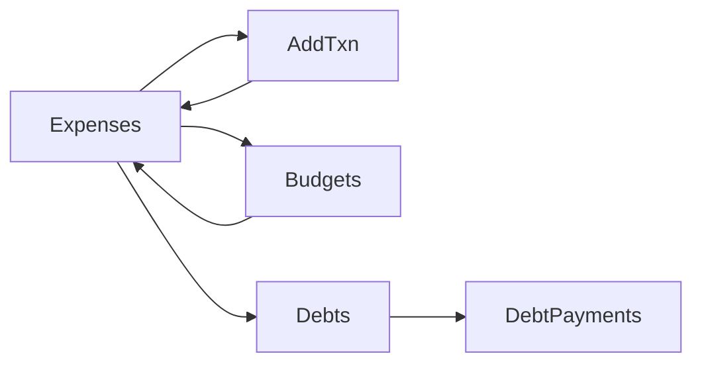

### D. Business logic
- `finance_repository.dart` (580 lines) — accounts, categories, recurring rules,
  transactions, budgets, debts, debt payments; `seedDefaultCategories()`
  (`main.dart:69`).
- Money stored as **integer paise**; aggregation providers
  (`aggregateSpending`, `spendingByCategoryProvider`) exist and are unit-tested.

### E. Data flow
`Expenses → financeRepository → transactions/budgets/debts → aggregate providers → UI`.

### F. Logic analyser

| # | Logic point | Status | Evidence |
| --- | --- | --- | --- |
| F1 | Money parsing/formatting (paise) | PASS (unit) | `test/unit/money_test.dart`, `spending_test.dart` |
| F2 | Category seeding idempotent | PASS | `seedDefaultCategories()` guard |
| F3 | Budget math | PARTIAL | repo + screen; limited direct tests |
| F4 | Debt payment math | PARTIAL | repo + screen |

### G. Tests
`test/unit/money_test.dart`, `test/unit/spending_test.dart`.

### H. Improvements
1. Split `expenses_screen.dart` (1152 lines) into per-tab widgets.
2. Add unit tests for budget/debt calculations.

---

## 13. Savings

### A. Overview
Savings goals with contributions.

### B. Page-by-page UI
- `savings_screen.dart` — goal list + contributions.

### C. Page linking

### D. Business logic
- `savings_goals` table managed via `finance_repository.dart`.

### E. Data flow
`Savings → financeRepository → savings_goals`.

### F. Logic analyser

| # | Logic point | Status | Evidence |
| --- | --- | --- | --- |
| F1 | Goal progress | PARTIAL | screen + repo; no dedicated test |

### G. Tests
Covered indirectly by money tests; no dedicated savings test.

### H. Improvements
1. Add a savings goal/progress unit test.

---

## 14. Meals

### A. Overview
Meal/food logging with nutrition.

### B. Page-by-page UI
- `meals_screen.dart` — log meals, food items.

### C. Page linking
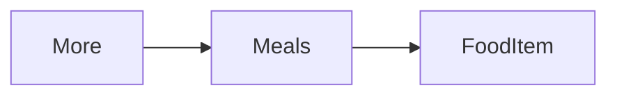

### D. Business logic
- `meal_repository.dart`; tables `meal_entries`, `food_items`.
- Daily nutrition totals are computed in the screen (verify macro sums).

### E. Data flow
`Meals → mealRepository → meal_entries/food_items`.

### F. Logic analyser

| # | Logic point | Status | Evidence |
| --- | --- | --- | --- |
| F1 | Nutrition totals | PARTIAL (UNVERIFIED) | screen-level; no unit test found |

### G. Tests
No dedicated meals test found.

### H. Improvements
1. Extract nutrition maths into a pure function and unit-test it.

---

## 15. Learning

### A. Overview
Courses, lessons, progress; seeds a starter course.

### B. Page-by-page UI
- `learning_screen.dart` — course/lesson list, progress.

### C. Page linking

### D. Business logic
- `learning_repository.dart` — `seedCourse()` (`main.dart:76`); tables `courses`,
  `lessons`, `learning_progress`. Curriculum unit-tested.

### E. Data flow
`Learning → learningRepository → courses/lessons/learning_progress`.

### F. Logic analyser

| # | Logic point | Status | Evidence |
| --- | --- | --- | --- |
| F1 | Curriculum structure | PASS (unit) | `test/unit/curriculum_test.dart` |
| F2 | Pronunciation scoring | **MISSING/UNVERIFIED** | no implementation confirmed |

### G. Tests
`test/unit/curriculum_test.dart`.

### H. Improvements
1. Clarify learning scope; implement or remove any pronunciation-scoring claims.

---

## 16. Music

### A. Overview
Local file/folder playback with playlists and background audio.

### B. Page-by-page UI
- `music_screen.dart` — folders/tracks/playlists, mini-player.

### C. Page linking

### D. Business logic
- Tables: `music_folders`, `music_tracks`, `playlists`, `playlist_items`,
  `music_state`; repo `music_repository.dart`; player `player_service.dart`.
- Background playback via `AudioService.init` (`main.dart:47-59`).
- Plugins: `just_audio ^0.9.42`, `audio_service ^0.18.15`, `file_picker ^8.1.6`,
  plus audio permissions (manifest `:14-21`).

### E. Data flow
`Music → musicRepository → Drift`; playback `AalumaiAudioHandler (just_audio) → MediaSession`.

### F. Logic analyser

| # | Logic point | Status | Evidence |
| --- | --- | --- | --- |
| F1 | Folder scan → tracks | PARTIAL (UNVERIFIED) | repo + plugin; device-dependent |
| F2 | Playlist persistence | PARTIAL | tables + repo |
| F3 | Background playback | UNVERIFIED | `main.dart:47-59`; device-dependent |
| F4 | Sleep timer | **MISSING/UNVERIFIED** | not confirmed in code |

### G. Tests
No dedicated music test found.

### H. Improvements
1. Add a pure unit test for playlist ordering/queue building.
2. Confirm/implement sleep timer if advertised.

---

## 17. Settings, More, About

### A. Overview
Preferences, module launcher, and app info.

### B. Page-by-page UI
- `settings_screen.dart` — theme, locale, notifications toggle, backup, permissions.
- `more_screen.dart` — grid/list linking to secondary modules.
- `about_screen.dart` — `AppInfo` (name `AALUMAI`/`ஆளுமை`, developer
  `Karthikeyan Asaithambi`, `releaseLabel = 'First Version'`).

### C. Page linking
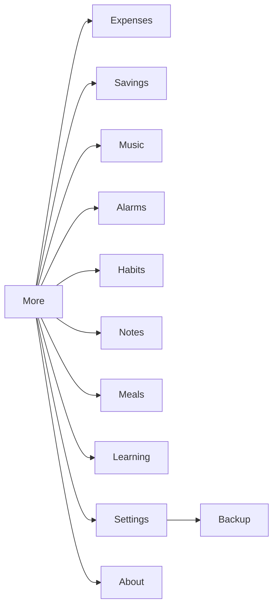

### D. Business logic
- `AppPreferences` (`app_preferences.dart`) — theme, locale, `notificationsEnabled`,
  dashboard keys. `notificationsEnabled` gates `requestPermissions()`
  (`main.dart:83-85,101-107`).
- `BackupService` exports/imports the DB (unit-tested).

### E. Data flow
`Settings → AppPreferences (SharedPreferences)`; backup ↔ Drift file.

### F. Logic analyser

| # | Logic point | Status | Evidence |
| --- | --- | --- | --- |
| F1 | Preferences persist | PARTIAL | `app_preferences.dart` |
| F2 | Backup/restore round-trip | PASS (unit) | `test/unit/backup_service_test.dart` |
| F3 | Notifications toggle gates permission prompt | PASS | `main.dart:83-85` |

### G. Tests
`test/unit/backup_service_test.dart`.

### H. Improvements
1. Confirm restore also reconciles alarms/reminders afterwards (stale schedules: see F8).

---

## 18. Cross-cutting issue register (prioritised)

| ID | Priority | Module | Issue | Evidence | Recommendation |
| --- | --- | --- | --- | --- | --- |
| ALM-1 | **P0** | Alarms | ~~Scheduled ring used channel default, not selected tone~~ **RESOLVED** | `notification_service.dart`, `alarm_scheduler.dart` | Per-sound versioned channels + raw resources; falls back to inexact mode |
| ALM-2 | **P0** | Alarms | Full-screen-intent launch not wired to ringing screen | `main.dart`, `notification_service.dart` | Handler via tap/launch-details; device test still UNVERIFIED |
| ALM-3 | **P0** | Alarms | ~~Exact-alarm capability never checked; failures swallowed~~ **RESOLVED** | `alarm_repository.dart`, `_SchedulingBanner` | Capability checked/requested; errors surfaced |
| ALM-4 | **P1** | Alarms | ~~Daily alarm scheduled 7× (same id)~~ **RESOLVED** | `AlarmPlanner.plan` | One entry for daily/one-time |
| ALM-5 | **P1** | Alarms | ~~`reconcile()` never cancelled stale schedules~~ **RESOLVED** | `AlarmRepository.reconcile` | Cancel all slots, then re-arm enabled |
| ALM-6 | **P2** | Alarms | Dead settings columns | `tables.dart` | Implement or remove |
| ALM-7 | **P1** | Alarms | Ordered challenge-to-dismiss (1–4, repeats, no snooze/dismiss, audio until all pass) | `alarm_challenges.dart`, `alarm_ringing_screen.dart`, editor | **Implemented**; schema v3 `challengeSequence` |
| FIT-1 | **P1** | Fitness | Personal records never recorded/shown | `fitness_repository.dart`; player `_logCurrentSet` | Call `updatePersonalRecord`; display best |
| FIT-2 | **P1** | Fitness | Run/walk keeps GPS running after leaving screen | `run_tracker.dart` (`RunTrackerController`) | `autoDispose` + confirm-exit |
| FIT-3 | **P1** | Fitness | Timed work step logs planned duration | `workout_player_screen.dart` | Log actual elapsed seconds |
| FIT-4 | **P1** | Fitness | Duplicate water UI | `fitness_screen.dart` (`_WaterTab` + `_WorkoutTab`) | Keep one |
| FIT-5 | **P2** | Fitness | Resume interrupted session unused | `activeSessionForPlan` | Offer resume |
| FIT-6 | **P2** | Fitness | Route data never displayed; `watchRuns` dead | history onTap null | Render route/polyline |
| FIT-7 | **P2** | Fitness | Wrong copy (stop uses `deleteConfirmBody`; goal uses `taskDue`) | `fitness_screen.dart`/player | Dedicated strings |
| FIT-8 | **P1** | Fitness | ~~No weekly planning / preferences~~ **RESOLVED** | `weekly_planner_screen.dart`, `workout_preferences_screen.dart`, schema v4 | Configurable preferences + Mon–Sun planner | 
| FIT-9 | **P1** | Fitness | ~~Exercise library lacked structure/metadata~~ **RESOLVED** | `exercise_library.dart` (42 seeds), `exercise_detail_screen.dart` | Full metadata + alternatives |
| FIT-10 | **P2** | Fitness | ~~No readiness gate, phases, or outcome tracking~~ **RESOLVED** | `session_flow.dart`, `workout_player_screen.dart` | Readiness + phases + outcome |
| FIT-11 | **P2** | Fitness | ~~No activity-volume guidance~~ **RESOLVED** | `who_guidance.dart`, workout tab card | WHO-informed (not certified) + disclaimer |
| HAB-1 | **P1** | Habits | Weekly-target habits always show streak 0 | `habits_screen`; `habit_streak.dart` | Use weekly streak |
| HAB-2 | **P2** | Habits | Measurable fields unused | `isMeasurable/goalValue/unit` | Display or remove |
| NOT-1 | **P1** | Notes | FAB creates orphan empty notes; delete unused | `notes_screen.dart`, `note_repository.dart` | Lazy-create; wire delete |
| SCH-1 | **P2** | Schedule | Event exceptions dead | `event_exceptions`, `addException` | Implement or remove |
| SCH-2 | **P2** | Schedule | Recurrence not reachable from UI | editor | Add picker (logic exists) |
| TSK-1 | **P3** | Tasks | `tagIds` never displayed | task repo/screen | Show tags or drop |
| QUA-1 | **P1** | All | Android runtime unverifiable locally (build blocked) | `BUILD_STATUS.md` | Fix SDK / CI device farm |
| QUA-2 | **P3** | All | Large screens (e.g. `expenses_screen.dart` 1152 lines) | file sizes | Split widgets |

---

## 19. Test coverage map

| Test file | Covers |
| --- | --- |
| `test/unit/alarm_time_test.dart` | next-ring / weekday math |
| `test/unit/alarm_challenges_test.dart` | math/memory/code challenges + `AlarmChallengeSequence` |
| `test/unit/backup_service_test.dart` | backup/restore round-trip |
| `test/unit/curriculum_test.dart` | learning curriculum |
| `test/unit/dashboard_sections_test.dart` | dashboard config parse |
| `test/unit/database_test.dart` | schema/tables (incl. no dashboard table) |
| `test/unit/enum_index_test.dart` | enum ↔ index stability |
| `test/unit/event_repository_test.dart` | schedule events |
| `test/unit/fitness_goal_test.dart` | goal math |
| `test/unit/geo_test.dart` | distance/pace math |
| `test/unit/habit_streak_test.dart` | streak math |
| `test/unit/money_test.dart` | paise parsing/format |
| `test/unit/player_state_test.dart` | workout player state |
| `test/unit/recurrence_test.dart` | recurrence expansion |
| `test/unit/recurring_rules_test.dart` | recurring rules |
| `test/unit/reminder_scheduler_test.dart` | reminder id ranges/scheduling |
| `test/unit/reminder_wiring_test.dart` | bootstrap reminder wiring |
| `test/unit/spending_test.dart` | spending aggregation |
| `test/unit/workout_queue_test.dart` | workout queue ordering |
| `test/unit/session_flow_test.dart` | readiness report, phase composition, session outcome |
| `test/unit/who_guidance_test.dart` | WHO-informed weekly progress |
| `test/unit/workout_preferences_test.dart` | preferences model + masks |
| `test/unit/weekly_planner_test.dart` | week math + schedule status |
| `test/unit/fitness_repository_test.dart` | prefs/schedule/session repo (incl. outcome, metadata, alternatives) |
| `test/unit/exercise_library_test.dart` | bundled library integrity + alternative resolution |
| `test/widget/alarm_ringing_test.dart` | ringing screen: sequential challenges, no snooze/dismiss, audio continuity |
| `test/widget/dashboard_config_test.dart` | dashboard config UI |
| `test/widget/workout_player_test.dart` | guided player UI |
| `test/widget/weekly_planner_test.dart` | planner UI: week render + generate week |
| `test/widget/workout_preferences_test.dart` | preferences UI: sections + safety persistence |
| `test/widget_test.dart` | app name resolves for all locales |

**Coverage gaps:** no OS-level alarm tone/FSI test, no music/meals/savings/notes
unit tests, no shell-boot widget test, no budget/debt math tests.

---

## 20. Roadmap

### Phase 1 — Alarm reliability (P0)
1. Ring with the **selected** tone (ALM-1).
2. Verify/fix full-screen-intent launch → ringing screen (ALM-2).
3. Check and surface exact-alarm capability (ALM-3).
4. Get a buildable Android target (QUA-1) so all of the above can be device-tested.

### Phase 2 — Alarm correctness + guided workout (P1)
5. Fix 7× daily scheduling (ALM-4) and stale-schedule reconcile (ALM-5).
6. Record/display personal records and progression (FIT-1).
7. Stop GPS on leave + resume interrupted runs (FIT-2, FIT-5).
8. Log actual timed durations (FIT-3); de-dupe water UI (FIT-4).
9. Weekly-target habit streaks (HAB-1); lazy notes + delete (NOT-1).

### Phase 3 — Polish & coverage (P2–P3)
10. Event exceptions or removal (SCH-1); recurrence picker (SCH-2).
11. Route rendering for runs (FIT-6); copy fixes (FIT-7).
12. Split oversized screens; add missing unit tests (QUA-2, section 19 gaps).

---

## 21. Appendix — UNVERIFIED (device-dependent) list

These require a real device/OS and could not be executed locally:

1. Alarm notification tone vs selected tone.
2. Full-screen-intent launch behaviour and lock-screen takeover.
3. Exact-alarm permission grant/deny handling on Android 12 vs 13+.
4. Boot/timezone-change `reconcile()` receivers actually firing.
5. Sequential challenge flow stopping audio only after all challenges pass.
6. Background audio / media session (`audio_service`).
7. Music folder scanning and file access.
8. Location permission + GPS run/walk tracking.
9. Notification permission prompt flow (`notificationsEnabled` gate).
