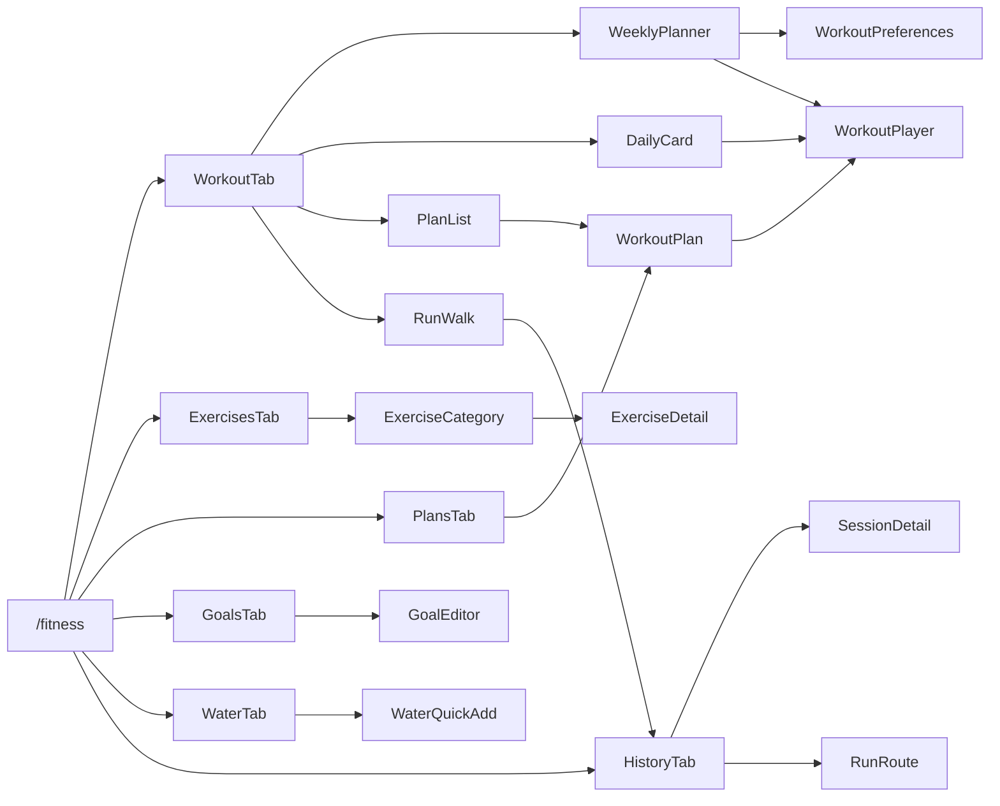

# Fitness Module

> Code-verified reference for the **Fitness** feature of AALUMAI.
> Covers behavior/logic **and** UI/UX in one place. Evidence is cited as `path:line`.
> Module root: `lib/features/fitness/`.

---

## 1. What it does

An offline, single-user fitness hub built on the app's shared architecture
(Riverpod + Drift/SQLite + go_router). It provides:

- A structured **exercise library** (bundled JSON dataset + user-created exercises).
- **Workout plans** and a guided **workout player** (warm-up → main → cool-down,
  sets/reps, timed holds, rests, set logging, personal records).
- A **weekly planner** generated from user **preferences**.
- A **WHO-informed** activity-guidance card.
- **GPS run/walk** tracking with a route map.
- **Water** logging, **body measurements**, a weight-trend chart, and **goals**.

There is **no network layer** — all data lives in the local database.

---

## 2. Layered architecture

```
┌──────────────────────────────────────────────────────────────┐
│ UI        fitness_screen.dart, workout_player_screen.dart,     │
│           workout_plan_screen.dart, weekly_planner_screen.dart,│
│           workout_preferences_screen.dart,                     │
│           exercise_category_screen.dart,                       │
│           exercise_detail_screen.dart, run_walk_screen.dart,   │
│           widgets/*                                            │
└───────────────▲──────────────────────────────────────────────┘
                │ ref.watch(provider)
┌───────────────┴──────────────────────────────────────────────┐
│ Data      data/fitness_repository.dart, data/run_tracker.dart,│
│           data/exercise_catalog.dart                          │
│           wraps AppDatabase; exposes Drift watch() streams     │
└───────────────▲──────────────────────────────────────────────┘
                │ drift queries
┌───────────────┴──────────────────────────────────────────────┐
│ Drift     AppDatabase (core/db) — aalumai.sqlite              │
└──────────────────────────────────────────────────────────────┘

Domain (pure, no Flutter/plugin deps — unit-testable):
  domain/session_flow.dart, workout_queue.dart, workout_preferences.dart,
  who_guidance.dart, fitness_goal.dart, geo.dart, weekly_planner.dart,
  exercise_collections.dart, exercise_format.dart
```

**Data flow:** `Fitness UI → fitnessRepositoryProvider → Drift → stream providers → UI`.
Run/walk: `RunTrackerController → fitnessRepository` (`docs/ARCHITECTURE.md:95`).
Domain types are intentionally pure so the planner, queue, readiness and geo math
can be tested without a device.

---

## 3. File map

| Area | File | Purpose |
| --- | --- | --- |
| Screens | `fitness_screen.dart` | Hub; 6 tabs. |
| | `workout_player_screen.dart` | Guided session player + summary. |
| | `workout_plan_screen.dart` | Plan detail/editor (reorder items). |
| | `weekly_planner_screen.dart` | Mon–Sun planner. |
| | `workout_preferences_screen.dart` | Preference editor. |
| | `exercise_category_screen.dart` | Browse/filter exercises. |
| | `exercise_detail_screen.dart` | Exercise detail. |
| | `run_walk_screen.dart` | GPS run/walk recorder. |
| Data | `data/fitness_repository.dart` | Data access + providers. |
| | `data/run_tracker.dart` | GPS controller/Notifier. |
| | `data/exercise_catalog.dart` | Loads `assets/data/exercises.json`. |
| Domain | `domain/workout_preferences.dart` | Prefs model + week generator. |
| | `domain/session_flow.dart` | Phases, readiness, session builder. |
| | `domain/workout_queue.dart` | Step queue + encode/decode. |
| | `domain/who_guidance.dart` | WHO thresholds + weekly progress. |
| | `domain/weekly_planner.dart` | Week date math. |
| | `domain/fitness_goal.dart` | Goal metric + progress. |
| | `domain/geo.dart` | Haversine, pace, route codec. |
| | `domain/exercise_collections.dart` | Collection/muscle/equipment labels. |
| | `domain/exercise_format.dart` | Difficulty/type/prescription labels. |
| Widgets | `widgets/daily_workout_card.dart` | WHO-informed "today" card. |
| | `widgets/route_map.dart` | Satellite route map. |
| | `widgets/exercise_gif.dart` | Cached GIF + fallback. |
| | `widgets/exercise_art.dart` | Custom-painted fallback art. |

---

## 4. Data model (Drift tables)

Schema is at **v4** (fitness redesign migration; additive). See `docs/DATABASE_SCHEMA.md:98`.

| Table | Key columns |
| --- | --- |
| `Exercises` | name, category (rec 0–8), exerciseType (0 strength / 1 cardio / 2 mobility / 3 balance), difficulty (−1 unknown), defaultSets/Reps/DurationSec, restSec, isTimed, isCustom, sourceId/slug/bodyPart/secondaryMuscles/sourceCategory/gifUrl, formTips, contraindications, easierAltId, harderAltId, localization keys. |
| `WorkoutSessions` | name, type (0 gym / 1 run / 2 walk), startedAt, endedAt, durationSec, distanceMeters, avgPaceSecPerKm, calories, routeJson, planId, scheduledId, outcome, stepIndex, totalSteps. |
| `WorkoutSetLogs` | sessionId, exerciseId, setIndex, reps, weightGrams, durationSec, restSec, isCompleted, isSkipped. |
| `WorkoutPlans` | name, dayOfWeek, kind, muscleGroups, description, notes, isArchived. |
| `WorkoutPlanItems` | planId, exerciseId, orderIndex, sets, reps, durationSec. |
| `WorkoutPrefs` | (single row id=1) planStyle, fitnessLevel, equipment(CSV), sessionMinutes, trainingDaysMask, restDaysMask, goal, goalMuscles(CSV), preferredMinuteOfDay, substitutions(`from>to,...`), safetyAcknowledged. |
| `WorkoutSchedules` | date, planId, title, muscleGroups(CSV), status, orderIndex, notes, sessionId. |
| `PersonalRecords` | exerciseId, recordType (`weightGrams`/`reps`/`durationSec`), value, recordedAt. |
| `FitnessGoals` | metric, targetValue, targetDate, note. |
| `WaterLogs` | amountMl, loggedAt, source. |
| `BodyMeasurements` | date, weightGrams, bodyFatPercent, chestCm, waistCm, hipCm, armCm, thighCm, note. |

`enum PersonalRecordKind { weightGrams, reps, durationSec }` — `fitness_repository.dart:14`.

---

## 5. Repository API & providers

### Providers (`fitness_repository.dart`)

| Provider | Type | Line |
| --- | --- | --- |
| `exerciseCatalogProvider` | `Provider<ExerciseCatalog>` | 945 |
| `fitnessRepositoryProvider` | `Provider<FitnessRepository>` | 949 |
| `exercisesProvider` | `StreamProvider<List<Exercise>>` | 956 |
| `workoutSessionsProvider` | `StreamProvider<List<WorkoutSession>>` | 960 |
| `exerciseRecordsProvider` | `StreamProvider.family<…, int>` | 964 |
| `runsProvider` | `StreamProvider<List<WorkoutSession>>` | 970 |
| `workoutSetLogsProvider` | `StreamProvider.family<…, int>` | 974 |
| `waterTodayProvider` | `StreamProvider<List<WaterLog>>` | 979 |
| `measurementsProvider` | `StreamProvider<List<BodyMeasurement>>` | 983 |
| `plansProvider` | `StreamProvider<List<WorkoutPlan>>` | 987 |
| `planItemsProvider` | `StreamProvider.family<…, int>` | 991 |
| `fitnessGoalsProvider` | `StreamProvider<List<FitnessGoal>>` | 995 |
| `workoutPreferencesProvider` | `StreamProvider<WorkoutPreferences>` | 999 |
| `scheduleWeekProvider` | `StreamProvider.family<…, DateTime>` | 1004 |
| `scheduleDayProvider` | `StreamProvider.family<…, DateTime>` | 1011 |
| `weeklyActivityProvider` | `Provider<WeeklyActivity>` (derived) | 1024 |
| `whoWeeklyProgressProvider` | `Provider<WhoWeeklyProgress>` | 1044 |
| `runTrackerProvider` | autoDispose `NotifierProvider` | `run_tracker.dart:191` |

### Public methods (`FitnessRepository`)

- **Library** — `seedExercises()` (35), `watchExercises({category})` (135), `addCustomExercise(...)` (146).
- **Sessions** — `watchSessions({limit})` (183), `startSession({name,type,planId,scheduledId,totalSteps,routeJson})` (194), `activeSessionForPlan(planId)` (219), `updateSessionProgress(sessionId,stepIndex)` (236), `finishSession(...)` (242), `deleteSession` (270), `logSet(...)` (274), `watchSetLogs` (302).
- **Personal records** — `updatePersonalRecord(...)` (312), `bestRecord(...)` (357), `watchRecords` (374), `progressionSuggestion(exerciseId)` (379; double-progression over last 9 logs).
- **Water** — `addWater` (399), `deleteWaterLog` (405), `watchWaterToday` (408), `waterTotalToday` (416).
- **Measurements** — `watchMeasurements` (423), `addMeasurement(...)` (428).
- **Runs** — `watchRuns()` (450).
- **Plans** — `watchPlans` (463), `createPlan` (467), `updatePlanMeta` (486), `addPlanItem` (506), `watchPlanItems` (528), `deletePlan` (534), `deletePlanItem` (537), `updatePlanItem` (541), `reorderPlanItems` (558), `seedStarterPlans()` (574).
- **Preferences** — `preferencesRow()` (668), `watchPreferences()` (683), `savePreferences(...)` (690).
- **Weekly planner** — `watchWeek(weekStart)` (719), `watchScheduleForDate(date)` (735), `addScheduleEntry(...)` (748), `updateScheduleStatus(...)` (772), `updateScheduleMeta(...)` (782), `moveScheduleEntry(id,date)` (802), `reorderScheduleEntries(...)` (814), `deleteScheduleEntry` (824), `duplicateScheduleEntry(id,{toDate})` (828), `clearPlannedWeek(weekStart)` (847), `generateWeek(weekStart)` (861).
- **Goals** — `watchGoals` (918), `createGoal(...)` (922), `deleteGoal(id)` (940).

---

## 6. Domain logic

### 6.1 Session flow — `domain/session_flow.dart`

- `SessionPhase { warmUp, main, coolDown }` — **main = index 1** so legacy queues default to main (8).
- `SessionOutcome { completed, partial, skipped, cancelled }` (11).
- `ReadinessReport` (14): `energy` (1 exhausted–5 fresh), `soreness` (1 none–5 very sore), `sleep` (1 poor–5 great), `note`; all default 3.
  - Score (35): `((energy + sleep + (6 - soreness)) / 3).round().clamp(1,5)` — soreness inverted.
  - `shouldReduceIntensity` (39): `score <= 2` (advisory only).
- `SessionBuilder` (44):
  - `selectWarmUps(all, {count:3, seed})` — categories 7/8, id-sorted, rotated by seed.
  - `selectCoolDowns(all, {count:2, seed})` — mobility (7) then stretches (8).
  - `buildSession({allExercises, items, warmUpCount:3, coolDownCount:2, seed})` (78) → warm-up steps + main steps (from plan items) + cool-down steps, composed into **one flat step list**.

### 6.2 Workout queue — `domain/workout_queue.dart`

- `WorkoutStepKind { work, rest }` (7).
- `WorkoutStep` (12): kind, exerciseId, exerciseName, category, gifUrl, setIndex, totalSets, reps, durationSec, isTimed, phase. Helpers: `isWork`, `isRest`, `isTimedCountdown` (`durationSec>0 && (isRest || isTimed)`), `withPhase`.
- `build({items, exercises, phase})` (73) — maps plan items to exercises by id (skips missing), sorts by `orderIndex`, then `_assemble`.
- `buildFromExercises(exercises, {phase})` (98) — uses each exercise's own defaults (quick workouts, warm-up/cool-down).
- `_assemble(specs, phase)` (113) — expands each spec into N work steps (sets clamp ≥ 1); inserts a **rest step after every work step except the last** using the exercise's `restSec` (skipped when `restSec == 0`). Rest steps inherit the preceding work step's metadata.
- `encodeSteps`/`decodeSteps` (170–215) — compact JSON snapshot with short keys, stored in `WorkoutSession.routeJson`. Decode returns `[]` on blank/invalid input and clamps indexes. **This is why resume survives later plan edits.**

### 6.3 Preferences & week generation — `domain/workout_preferences.dart`

Enums:
- `WorkoutPlanStyle { balanced, muscleSplit, fullBody, cardioFocus }` (4)
- `WorkoutGoal { generalHealth, strength, endurance, flexibility, weightManagement }` (7)
- `FitnessLevel { beginner, intermediate, advanced }` (16; aligns with difficulty 0–2)
- `ScheduleStatus { planned, completed, skipped, rest, missed }` (19)
- `PlanWarningKind { duplicateExercise, consecutiveSameMuscle, tooManyConsecutiveDays, heavyVolume }` (224)

`WorkoutPreferences` (25) — immutable; defaults: balanced / beginner / empty equipment / 30 min / `trainingDaysMask = 0x1F` (Mon–Fri) / `restDaysMask = 0` / generalHealth / no goal muscles / preferred minute −1 / no substitutions / safety not acknowledged. Helpers `trainsOn`/`restsOn`, `copyWith`, CSV codecs, `fromRow` (with clamping).

Supporting: `TrainingDays` bit helpers (154; bits 0..6 = Mon..Sun), `PlannedItem` (182; `estimatedSec` = per-set × sets + rests, per-set = `durationSec` or `reps*4`, clamped 15–90), `PlannedDay` (206), `PlanWarning` (231).

`WhoDailyPlan` (246) — strength focus per weekday:
Mon `[chest,biceps]`, Tue `[back,triceps]`, Wed `[legs,shoulders]`, Thu `[chest,biceps]`,
Fri `[back,triceps]`, Sat `[legs,core]`, Sun `[]` (active recovery). `cardio` and `yoga` every day.

`WeekPlanGenerator` (282):
- `generate({preferences, exercises, weekStart, substitutions})` (311) — loops Mon→Sun; a day trains when `trainsOn && !restsOn`, else `isRest`. Training days cycle style-specific combos.
- `generateWhoDay({date, preferences, exercises, substitutions})` (357) — uses `WhoDailyPlan.groupsFor(weekday)`, `perGroupOverride: 2`.
- Selection: max difficulty = `level.index + 1`; per-group count `ceil(minutes/8)` clamped 1–3 (cardio/yoga capped at 1); equipment-filtered; id-sorted; deduped.
- `validate({days, preferences})` (487) — **advisory** warnings only (never blocks): duplicate exercise, same muscle on consecutive training days, ≥4 consecutive training days, day estimate > 1.5× session length.

### 6.4 WHO guidance — `domain/who_guidance.dart`

`WhoGuidance` thresholds: 150–300 moderate-equivalent aerobic minutes/week, ≥2 strength days (vigorous counts ×2). `whoWeeklyProgress()` derives this week's aerobic minutes and strength days from completed sessions. Always surfaced as **"informed by WHO guidance"**, never "WHO-certified", with a not-medical-advice disclaimer.

### 6.5 Goals — `domain/fitness_goal.dart`

`FitnessGoalMetric { workoutsPerWeek, waterDaily, distanceWeekly }`; `goalProgress`, `goalCurrentValue`, `goalUnit` compute live progress from `weeklyActivityProvider` / `waterTodayProvider`.

### 6.6 Geo — `domain/geo.dart`

`GeoPoint` (JSON codec), haversine `distance`, path distance, pace, distance/pace/duration formatting, route encode/decode.

### 6.7 Week math — `domain/weekly_planner.dart`

`WeekDates` (Monday-first): `startOfWeek`, `weekOf`, `shiftWeeks`, `isSameDay`, `dayKey`, `isPast`; `scheduleStatusFromIndex()`.

---

## 7. State management

Riverpod only. The repository is a `Provider`; all lists are Drift-backed
`StreamProvider`s; filtered queries use `.family` (plan items by planId, records
by exerciseId, set logs by sessionId, week/day schedules by DateTime). Derived
providers (`weeklyActivityProvider`, `whoWeeklyProgressProvider`) compute from
streams. Ephemeral UI state (timers, form fields) lives in widget state.

`RunTrackerController` is an **autoDispose Notifier** — on dispose it cancels the
GPS subscription/timer and deletes an unsaved active session so tracking never
continues in the background (`run_tracker.dart:76`).

---

## 8. Navigation

- Registered route: **`/fitness`** (`AppRoutes`, `core/router/app_router.dart`).
- The Fitness tab is a `StatefulShellBranch` of the `AppShell` bottom nav (icon
  `fitness_center`).
- Secondary fitness screens (player, plan, planner, preferences, category,
  detail, run/walk) are pushed via `MaterialPageRoute` (consistent with the
  app's modal/full-screen pattern).



---

## 9. UI / UX

### 9.1 `FitnessScreen` — the hub (`fitness_screen.dart`)

`DefaultTabController(length: 6)` → `Scaffold` with a scrollable `TabBar` and a
`TabBarView` (28–64). Tabs, in order:

| # | Tab | Widget | Contents |
| --- | --- | --- | --- |
| 1 | Workout | `_WorkoutTab` (66) | `DailyWorkoutCard`; `_ResumeCard` if an unfinished session; "Start workout"; "Weekly planner"; `_WhoProgressCard`; plan cards (play/tap); measurements; "Run / Walk"; `_WeightTrendCard`. |
| 2 | Exercises | `_ExercisesTab` (507) | "All" card + one card per `WorkoutCollection`; "Your exercises" (custom); FAB **New exercise**. |
| 3 | Plans | `_PlansTab` (749) | Plan list (play/tap/long-press delete); FAB **New plan**. |
| 4 | Goals | `_GoalsTab` (844) | Goal list with live progress bars; long-press delete; FAB **New goal**. |
| 5 | Water | `_WaterTab` (1028) | `_WaterQuickAdd` — progress + +200/+300/+500 ml chips. |
| 6 | History | `_HistoryTab` (1037) | Merged gym sessions + runs/walks, newest first; tap opens detail; long-press deletes. |

**Key helpers:** `startQuickWorkout` (224), `startGuidedPlan` (252),
`resumeWorkout` (322), `showGoalEditor` (939), `showMeasurementEditor` (1241),
`showRunRoute` (1109), `showSessionDetail` (1156), `exerciseNameFor` (1232).

**Dialogs:** resume-plan (266), custom-exercise form (631), new-plan (817), goal
editor incl. date picker (944), measurement (1245), shared `confirmDialog` for
deletes.
**Bottom sheets** (`showModalBottomSheet`, drag handle, scroll-controlled):
exercise picker `_ExercisePickerSheet` (345), run route `_RunRouteSheet` (1118),
session detail `_SessionDetailSheet` (1165).

> UX note: `_WaterQuickAdd` is embedded by **both** `_WorkoutTab` and `_WaterTab`
> (legacy issue FIT-4). New work should keep water in the Water tab only.

### 9.2 `WorkoutPlayerScreen` — guided player (`workout_player_screen.dart`)

Constructor params: `title`, `steps`, optional `planId`, `scheduledId`,
`resumeSessionId`, `startIndex` (default 0), `checkReadiness` (default false).

**Stage A — Bootstrap (70–129):** post-frame `_bootstrap`. If `checkReadiness`
and not resuming, `_showReadinessCheck()` runs first; **cancelling pops the
screen and creates no session** (89–91). Session created/resumed with
`routeJson = encodeSteps(steps)`. Wakelock enabled non-blockingly (105; failures
surface an `ErrorState` with retry).

**Stage B — Readiness dialog (133–217):** non-dismissible AlertDialog with three
1–5 sliders (energy/soreness/sleep), a live low-readiness hint, and a notes
field. Actions: Cancel / "I am ready" (returns a `ReadinessReport`).

**Stage C/D — Steps & timers:** `_enterStep` (226) sets up the step; timed
countdown steps run a 1 s `Timer.periodic` (250). At `_remaining <= 1` →
`_advance(log: step.isWork)`: **rests auto-advance without logging**, timed work
steps log the **actual held duration** (from `_stepWatch`).
- Rest UI: `_RestContent` (735) — self_improvement icon, "Rest", big countdown.
- Work UI: `_WorkContent` (686) — name, "Set x / y", then big countdown (timed)
  or target reps.

**Stage E — Logging:** rep sets open `_promptSetDialog` (329) — Actual reps +
Weight used; Skip advances without logging; Complete set logs and advances.
`_logCurrentSet` (266) also tries `updatePersonalRecord` and shows a **"new
personal best"** SnackBar.

**Stage F — Navigation:** Previous/Next exercise buttons (630) use
`_adjacentExercise` (408) to jump to the first step of the next/previous
*distinct* exercise (skipping rests and same-exercise sets); no next → finish.

**Stage G — Pause/resume (433):** cancels/restarts timers and stopwatches; shows
a "Workout paused" label; the primary button toggles Pause ↔ Resume for timed
steps.

**Stage H — Primary action (654):** Rest → Skip; timed work → Pause/Resume;
rep work → Complete set.

**Stage I — End:** AppBar "End workout" and `PopScope(canPop:false)` (472)
intercept back with a confirm dialog. Outcome (452): all steps → `completed`;
`index > 0` → `partial`; else `cancelled`. `finishSession` stores total duration.

**Stage J — Summary (`_SummaryView`, 767):** trophy, "Workout complete" + outcome
label, and rows for total time, exercises completed/planned, sets completed,
total reps, total weight (if > 0), skipped exercises. Done pops with the outcome.

**Chrome:** phase chip (warm-up/main/cool-down, 551); low-readiness hint (568);
`n / total` counter + `LinearProgressIndicator` (580).

### 9.3 `DailyWorkoutCard` (`widgets/daily_workout_card.dart`)

Renders only when preferences and exercises are loaded (else `SizedBox.shrink`).
Generates today's WHO day, shows weekday + focus (or "Active recovery day"), and
a **truthful preview** of the same composition the player will use: three
`_PhasePreview` sections (warm-up / main / cool-down) with exercise chips.
"Start today's workout" (134) composes warm-up + non-yoga main + cool-down and
pushes the player with `checkReadiness: true`, **no planId/scheduledId** (ad-hoc).

### 9.4 Weekly planner (`weekly_planner_screen.dart`)

Mon–Sun cards, week navigation (prev/next/today), **generate week from
preferences**, and per-entry actions (start/edit/move/reorder/duplicate/mark-rest/
restore/skip/delete) plus add-from-plan sheet and non-blocking warnings. Schedule
status derives from the session outcome.

### 9.5 Preferences (`workout_preferences_screen.dart`)

Edits plan style, level, session length, training/rest days, goal, focus muscles,
equipment (with custom add), preferred time, and a **safety acknowledgement**
(persisted in `workout_prefs`).

### 9.6 Exercise library (`exercise_category_screen.dart`, `exercise_detail_screen.dart`)

Browse by collection or all, with search/filters (muscle, equipment, difficulty).
Detail shows GIF, muscles, equipment, prescription, instructions, personal bests,
form tips / common mistakes / contraindications, and easier/harder alternatives.
Difficulties equal to `kUnknownDifficulty` (−1) are hidden rather than guessed.
GIFs use `exercise_gif.dart` with `exercise_art.dart` as fallback.

### 9.7 Run/Walk (`run_walk_screen.dart`, `data/run_tracker.dart`)

- **Idle:** Run/Walk `SegmentedButton`, `RouteMapView` (satellite, waiting hint),
  big distance readout, Time/Pace stats, Start button, permission error card with
  "Open settings".
- **Tracking:** `geolocator` stream, high accuracy, `distanceFilter: 3`; 1 s timer
  accumulates elapsed; pause/resume; `PopScope` blocks back and routes through a
  3-way dialog (Cancel / Discard / Save).
- **Save:** `stopAndSave()` encodes the route and calls `finishSession`; finished
  sessions appear in History and open in `_RunRouteSheet` with the map.
- **Safety:** `RunTrackerController` is autoDispose and deletes unsaved sessions
  on dispose (no background tracking).

---

## 10. End-to-end flows

**Guided plan:** plan card play → `startGuidedPlan` → if active session for plan,
resume dialog (Resume / Start fresh; fresh finishes the old one as `cancelled`)
→ `SessionBuilder.buildSession` → push player with `checkReadiness: true` →
readiness gate → session with full step snapshot → play/log → summary with
outcome.

**Quick workout:** "Start workout" → `startQuickWorkout` → `_ExercisePickerSheet`
multi-select → `WorkoutQueue.buildFromExercises` → player (no readiness check).

**Daily card:** `DailyWorkoutCard` → `_start` → composed steps → player with
readiness → ad-hoc session (no plan link).

**Resume:** `_ResumeCard`/`resumeWorkout` → decode steps from `routeJson` → player
with `resumeSessionId` and clamped `startIndex`.

**Run/Walk:** Start → track → Stop/Save → `finishSession` → History → route sheet.

**Weekly planning:** preferences → `generateWeek` → `WorkoutSchedules` rows →
planner cards → start a day → player → outcome updates schedule status.

---

## 11. Seeding & first-run

`main.dart` best-effort bootstrap calls `seedExercises()` and `seedStarterPlans()`
(91–92), each guarded so a failure never blocks launch. `seedExercises` imports
the bundled `assets/data/exercises.json`, removes stale non-custom rows, and is
skipped once any row has a `sourceId`. `seedStarterPlans` creates
"Beginner full body", "Dumbbell strength", "Bodyweight HIIT".

---

## 12. Configuration

- **Safety acknowledgement** — `WorkoutPrefs.safetyAcknowledged`; the preferences
  screen shows guidance and requires acknowledgement.
- **Workout music** — app-level prefs `workoutMusicEnabled`,
  `workoutMusicPauseOnRest`, `workoutMusicStopAtEnd` (`AppPreferences`).
- **WHO guidance** is advisory-only; messaging never claims WHO certification.
- Bundled dataset is **offline** (`assets/data/exercises.json`).

---

## 13. Tests

- **Unit:** `workout_queue_test.dart`, `player_state_test.dart`,
  `workout_preferences_test.dart`, `weekly_planner_test.dart`,
  `session_flow_test.dart`, `who_guidance_test.dart`, `fitness_goal_test.dart`,
  `geo_test.dart`, `fitness_repository_test.dart`, `exercise_library_test.dart`.
- **Widget:** `workout_player_test.dart`, `weekly_planner_test.dart`,
  `workout_preferences_test.dart`, `workout_selection_test.dart`,
  `exercise_library_ui_test.dart`, `daily_workout_test.dart`.
- **Support:** `fitness_fixtures.dart`.

Baseline: the suite is green including the fitness tests (see `BUILD_STATUS.md`).

---

## 14. Known notes / follow-ups

- **Duplicate water UI** — `_WaterQuickAdd` is embedded in both `_WorkoutTab` and
  `_WaterTab` (FIT-4; `fitness_screen.dart`). Consider keeping it in the Water
  tab only.
- **Legacy dead logic** — `progressionSuggestion` and `progression` hints exist but
  are not yet surfaced in the player UI.
- **Platform-dependent behavior** — wakelock, GPS capture, and notifications are
  best-effort and marked unverified without a device (`BUILD_STATUS.md`).
- **Schema docs** — `docs/DATABASE_SCHEMA.md` §Fitness still lists the pre-redesign
  columns; the authoritative schema is the Drift v4 definition.
- **Navigation style** — secondary screens use `MaterialPageRoute` rather than
  `go_router` routes, consistent with the rest of the app.
